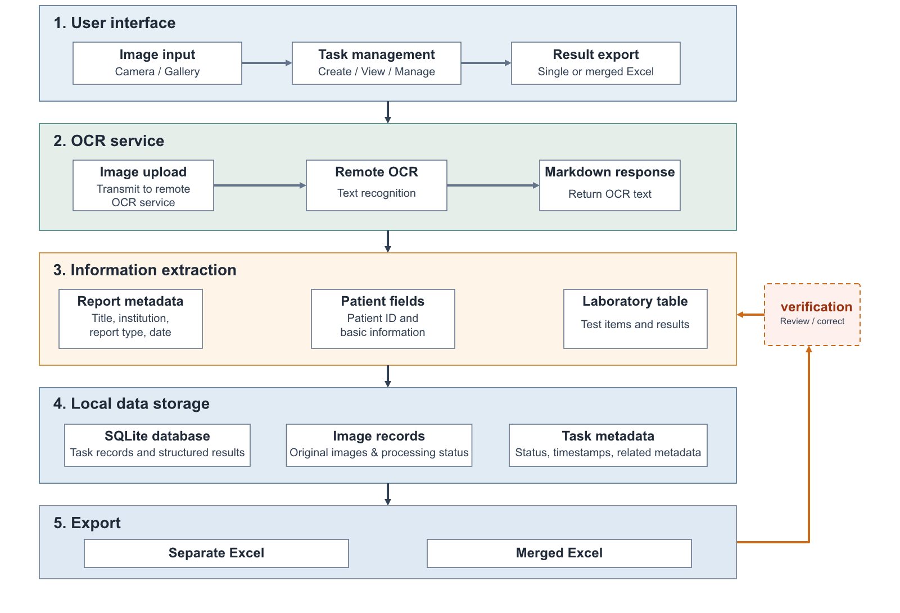

<p align="center">
  
</p>

<h1 align="center">IcareScan</h1>

<p align="center">
  An Android application for the automated digitization and structuring of clinical laboratory reports, intended to support downstream research in <em>clinical laboratory omics</em> (Clinlabomics).
</p>

<p align="center">
  <a href="com.icare.scan.apk.1.1.1?raw=true">Download Android APK (1.1.1)</a>
</p>

---

## Overview

IcareScan is a mobile (Android) application designed to bridge the gap between unstructured, paper-based (or image-based) clinical laboratory reports and structured, machine-readable data suitable for quantitative research. By capturing a photograph of a conventional laboratory report, the application performs optical character recognition (OCR) and subsequent parsing to extract patient information, test items, and reference values into a structured schema. This addresses a common bottleneck in retrospective and prospective clinical laboratory data collection, where source reports are frequently distributed as printed documents or unstructured images rather than structured electronic records.

The resulting structured output is intended to facilitate downstream analyses in clinical laboratory omics (Clinlabomics) research, including cohort-level aggregation, longitudinal trend analysis, and integration with other structured clinical or -omics data sources.

## Platform

This application is distributed as a native Android package (`.apk`) and is intended for installation on Android mobile devices. It is not a web application, desktop application, or cross-platform build.

**Installation**

1. Download the package: [com.icare.scan.apk.1.1.1](com.icare.scan.apk.1.1.1?raw=true).
2. Transfer the `.apk` file to an Android device, if not downloaded directly on-device.
3. Enable installation from unknown sources (if required by the device's Android version), and install the package.

## Version Information

The checked-in Android client source declares version **1.0.0** in `src/manifest.json` and `src/package.json`. The existing downloadable APK is named `com.icare.scan.apk.1.1.1`. The correspondence between this APK and the checked-in source revision has not yet been verified; these identifiers should not be assumed to represent the same build. The version used for the manuscript evaluation also requires confirmation against the relevant software artifact.

## Core Workflow



*Workflow overview. Users manually de-identify report images before capture or import. Verification and correction are performed in external spreadsheet tools after export.*

1. **Manual Pre-Upload De-identification (User Responsibility):**
   IcareScan **does not perform automatic image de-identification**. Users must mask or remove patient-identifying information before capturing or importing laboratory report images.
2. **Image Acquisition & Task Management (`src/pages/plugins/addPage.vue`):**
   Users create a recognition task (assigned a unique 6-digit task ID `billNo`), capture or select up to 100 images from the device camera or photo gallery, preview/remove images, save drafts locally, or submit the task for OCR.
3. **Remote OCR Transmission (`src/config.js`, `src/pages/plugins/addPage.vue`):**
   Images are uploaded sequentially over **HTTPS** (`uni.uploadFile`) to the configured backend relay, which forwards recognition requests to an external **iFLYTEK OCR service** and returns a JSON payload containing recognized Markdown text to the app.
4. **Local SQLite Storage (`src/db/sqlite.js`, `src/db/action.js`):**
   Task records (`report_record_new`), original base64 images and Markdown OCR responses (`report_record_img`), and predefined laboratory test names (`report_inspection_items`, ~150 common analytes) are stored locally in an **unencrypted** SQLite database at `_downloads/report.db`.
5. **Client-Side Rule-Based Parsing & Excel Export (`src/pages/index/scanner.vue`):**
   Upon export, the client parses Markdown headings, colon-delimited key–value lines, and pipe-delimited tables (`| ... |`), matches analyte abbreviations against `report_inspection_items` (dynamically appending unmatched abbreviations as new columns), extracts numeric values via regular expression (`/-?\d+(\.\d+)?/`), and writes an HTML-wrapped Excel table (`.xlsx`) to the Android public downloads directory (`plus.io.PUBLIC_DOWNLOADS`).
   - **Normal Export:** Exports one `.xlsx` file per task with **one row per report image** (`img_billNo`, `img_name`, and analyte columns).
   - **Merge Export:** Computes the **column-wise arithmetic mean** across all images in the task and exports a single summary row .
6. **External Manual Verification:**
   IcareScan does not include an in-app tabular value editor; users open the exported `.xlsx` file on a mobile viewer or desktop computer and verify/correct values against source images using the task and image sequence ID (`billNo_001`, etc.).
   
## OCR Service and Backend Dependency

The Android client depends on an external backend relay for OCR recognition. The default relay is identified in [`src/config.js`](src/config.js) as a service operated by **Chengdu Qianli Zhiwai Technology Co., Ltd.**, forwarding requests to the **iFLYTEK Open Platform**. Its endpoint can be changed through `ocrApiUrl`.

This repository currently includes the Android client source but does not include the backend relay implementation. Running OCR therefore requires access to a compatible relay service. The exact iFLYTEK OCR product and version, applicable service terms, and image-retention and deletion policies for both the relay and OCR provider have not yet been documented in this repository and require confirmation.

## Project File Structure

The following tree shows the main Android client source files and evaluation materials available in this repository. The current client source is located in `src/`.

```
Icare-scan/
├── LICENSE                       # Apache-2.0 license
├── README.md                     # Project documentation
├── src/                          # UniApp (Vue 3) Android client source
│   ├── App.vue                   # Application lifecycle & SQLite table initialization
│   ├── main.js                   # Vue 3 entry point & global i18n mixin registration
│   ├── config.js                 # Configurable HTTPS OCR relay and feedback endpoints
│   ├── manifest.json             # UniApp / Android permissions, SQLite & Camera modules
│   ├── pages.json                # Application pages and tab-bar routing
│   ├── package.json              # NPM dependencies (image-tools, xlsx)
│   ├── db/
│   │   ├── sqlite.js             # HTML5+ SQLite wrapper (_downloads/report.db)
│   │   └── action.js             # CRUD operations for task, image, and item tables
│   ├── libs/
│   │   ├── i18n.js               # Bilingual (Chinese/English) UI text & privacy disclosures
│   │   ├── lang.js               # Reactive language switcher mixin
│   │   └── resources.js          # Static asset path definitions
│   ├── pages/
│   │   ├── index/index.vue       # Startup instructions & predefined analyte dictionary seeding
│   │   ├── index/scanner.vue     # Task list, Markdown parser, Excel export (row-by-row & averaged)
│   │   ├── plugins/addPage.vue   # Task creation, camera/gallery capture, HTTPS OCR submission
│   │   ├── plugins/scanner.vue   # Legacy single-mode task view
│   │   ├── report/ocr-report.vue # Legacy single-report detail preview
│   │   └── regard/index.vue      # Language switching (ZH/EN) & feedback submission
│   ├── components/               # Shared UI components
│   ├── assets/ & static/         # Stylesheets, icon fonts, and static images
│   ├── uni_modules/ & uview-ui/  # Bundled UniApp & uView UI modules
│   └── unpackage/res/icons/      # Application launcher icons referenced by manifest.json
└── evaluation/                   # De-identified multi-hospital evaluation dataset (187 reports, 3,610 items)
    ├── README.md                 # Dataset schema and audit notes
    ├── evaluation_dataset.csv    # Full item-level evaluation table across 3 hospitals
    └── fushun_cbc_alias_columns.csv # Raw alias-column outputs (NEUT%, NEUT#, MONO#, EO#, BASO#)
```

## Notes on Localization

IcareScan provides Chinese and English interface options. The current report-parsing rules are designed for Chinese-language laboratory reports and retain Chinese keywords to identify report titles and selected fields. Supporting English-language reports would require adapting and validating these parsing rules.

## Evaluation Data

The item-level evaluation data are available in the [evaluation](evaluation/) directory, including extracted results, manually verified reference values, and evaluation annotations. See the [evaluation data documentation](evaluation/README.md) for file descriptions, the data schema, and evaluation definitions.

## Citation

If you use IcareScan in your research, please cite the accompanying manuscript (citation details will be updated upon publication):

> Tang H, Zhou X, Mo B, Wang H, Guo X, Peng Y, Liao Y, Huang J, Luo H, Li S. *IcareScan: A Tool for Automated Recognition and Structured Extraction of Clinical Laboratory Reports.* Unpublished manuscript.

---

## License

This project is licensed under the **Apache License, Version 2.0** — see the [LICENSE](LICENSE) file for details.
